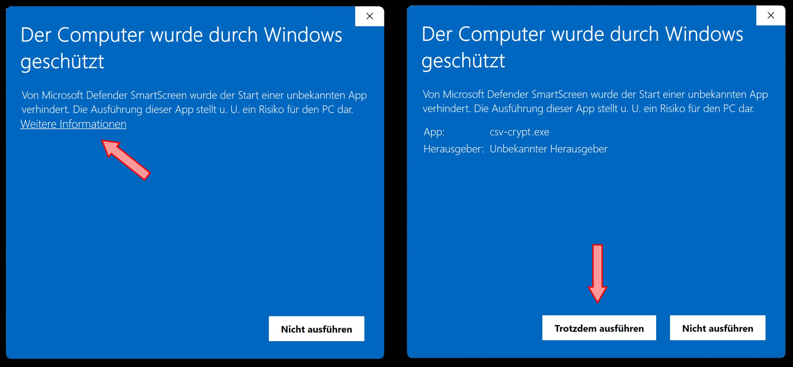
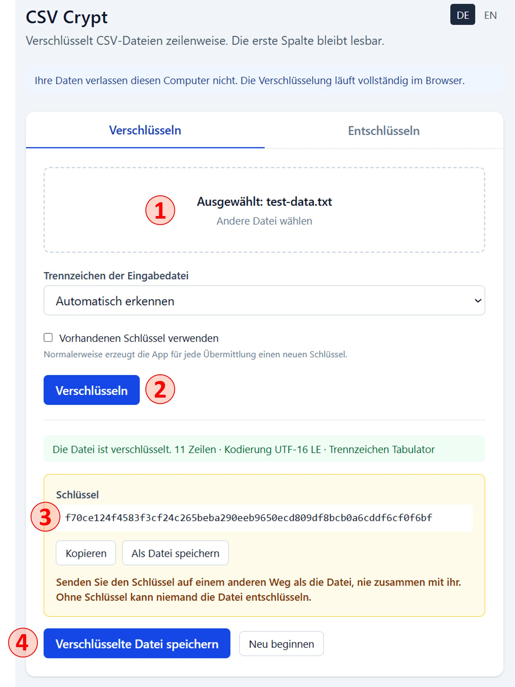
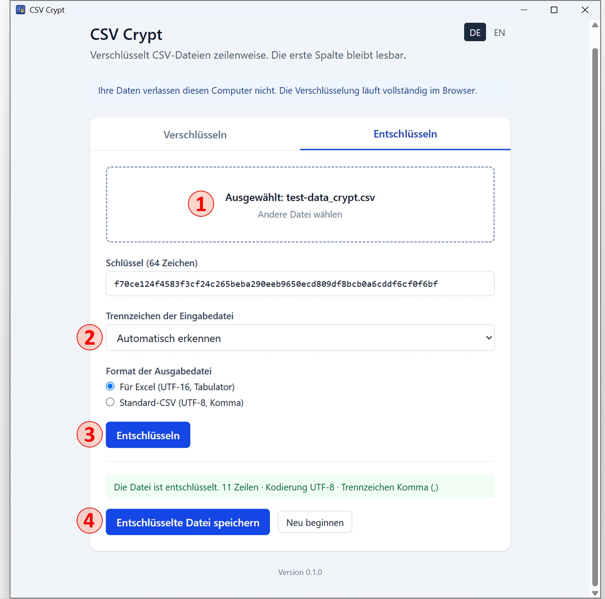

# CSV Crypt Web

Browser UI for [csv-crypt](https://github.com/life-research/csv-crypt). It
encrypts a CSV file line by line: column 1 stays readable, all other columns
are encrypted into column 2. The file format is identical to the CLI
(v0.5), so both tools can read each other's files.

The app takes only files with the extension `.csv` or `.txt` (Excel's
"Unicode Text"). It also checks the content: Excel files, other Office
files, PDFs, images, archives and other binary files get a message and are
not processed, also when they have a `.csv` name.

All encryption runs in the browser (Web Crypto API). The data never leaves
the computer. A Content Security Policy blocks all network requests.

## Install

Download the executable of the application for your OS (At the moment, there is only a version for Windows:)

- [Windows](https://github.com/life-research/csv-crypt-app/releases/latest)

The executable needs no installation. Save it and start it with a double
click.

### Windows SmartScreen

The executable has no code signature yet. Because of this, Windows can show
the warning "Windows protected your PC" when you start it for the first
time. To start the app:

1. Click **More info** (German: **Weitere Informationen**).
2. Click **Run anyway** (German: **Trotzdem ausführen**).

<p align="center">
  
</p>

Instead, you can unblock the file before you start it:

1. Right-click the file and click **Properties** (German: **Eigenschaften**).
2. On the tab **General**, select **Unblock** (German: **Zulassen**) and
   click **OK**.

Or in PowerShell: `Unblock-File .\csv-crypt-X.Y.Z-windows-x64.exe`

Do this only for a file that you downloaded from the release page and
[verified](#verify-the-download).

If there is no **Run anyway** button, see
[Smart App Control and managed devices](#smart-app-control-and-managed-devices).

## Usage

### Encrypt a file

1. In the tab **Encrypt**, select the file. Drop it on the field or click
   the field.
2. Click **Encrypt**.
3. Click **Save encrypted file** and save the file on your computer.
4. Save the key: click **Save as file** or **Copy**.

Send the key on a different channel than the file, never together with it.
Without the key, nobody can decrypt the file.

<p align="center">
  
</p>

### Decrypt a file

1. In the tab **Decrypt**, select the encrypted file.
2. Enter the key (64 characters).
3. Select the format of the output file: **For Excel** or **Standard CSV**.
4. Click **Decrypt**.
5. Click **Save decrypted file** and save the file on your computer.

<p align="center">
  
</p>

## File size

The app encrypts CSV files up to 200 MB and decrypts files up to 500 MB.
For larger files, it shows a message (`src/lib/limits.ts`). Split such
files into smaller files.

An encrypted file is larger than the original: approx. 1.5 to 2.5 times
for typical tables, more for tables with very short rows. If the encrypted
file would be larger than 500 MB, the app stops, because it could not
decrypt the file again.

Measured in Chrome 157 (headless, Linux, 30 GB RAM), with 7 short columns
per row:

| Input  | Rows        | Encrypt          | Decrypt          |
| ------ | ----------- | ---------------- | ---------------- |
| 150 MB | approx. 3 M | 87 s, 1.8 GB RAM | 70 s, 2.2 GB RAM |
| 200 MB | approx. 4 M | 117 s, 2.2 GB    | 95 s, 2.7 GB     |

Computers with less RAM (e.g. 8 GB) and the desktop app (WebView2 on
Windows) are not measured yet. On such computers, large files can fail
earlier.

## More about the download

### Smart App Control and managed devices

Some computers do not let you start the app at all. There is then no
**Run anyway** button:

- **Smart App Control** (Windows 11) blocks all unsigned apps. We do not
  recommend to turn it off for this app.
- On a **managed device** (for example a computer of your employer), a
  policy of your IT department can block apps that it does not know.

In both cases, ask your IT department to allow the app. Give them the link
to the release and the checksum of the file. Until the executable has a
code signature, there is no other solution.

### Verify the download

Each release contains a checksum file (`.sha256`). Compare it with the
checksum of your download.

In PowerShell:

```powershell
Get-FileHash .\csv-crypt-X.Y.Z-windows-x64.exe -Algorithm SHA256
Get-Content .\csv-crypt-X.Y.Z-windows-x64.exe.sha256
```

The two values must be the same (PowerShell shows the checksum in capital
letters). On Linux or macOS:

```sh
sha256sum -c csv-crypt-X.Y.Z-windows-x64.exe.sha256
```

The checksum shows that the download is complete. The SLSA provenance
(`.intoto.jsonl`) also shows that this repository's workflow built the
executable from the release tag. Check it with
[slsa-verifier](https://github.com/slsa-framework/slsa-verifier):

```sh
slsa-verifier verify-artifact csv-crypt-X.Y.Z-windows-x64.exe \
  --provenance-path csv-crypt-X.Y.Z-windows-x64.exe.intoto.jsonl \
  --source-uri github.com/life-research/csv-crypt-app \
  --source-tag vX.Y.Z
```

The provenance does not replace a code signature: Windows still shows the
SmartScreen warning.

### Official and unofficial builds

Only the files on the
[release page](https://github.com/life-research/csv-crypt-app/releases)
are official. All other builds are unofficial:

- builds that you make yourself (see [Desktop app](#desktop-app-tauri)),
- builds of pull requests and manual workflow runs. Their file name
  contains the commit, for example
  `csv-crypt-X.Y.Z-dev.3f2a9c1-windows-x64.exe`.

Do not give unofficial builds to other persons.

## Builds

| Build | Command                 | Output                        | Use                         |
| ----- | ----------------------- | ----------------------------- | --------------------------- |
| A     | `npm run build`         | `build/`                      | Static web app (nginx, K8s) |
| B     | `npm run build:single`  | `build-single/csv-crypt.html` | One file, opens via file:// |
| C     | `npm run build:desktop` | `build-desktop/`              | Frontend of the desktop app |

Build B also writes `csv-crypt.html.sha256`. Distribute the file only from
one trusted place, together with its checksum.

The browser needs a secure context: HTTPS for build A (or `localhost`),
file:// for build B.

## Desktop app (Tauri)

`src-tauri/` wraps build C in a desktop app for Windows and macOS. The app
has no file system access. It can only save files through the native
"Save as" dialog (command `save_file` in `src-tauri/src/save.rs`).
Tauri sets the same CSP as the web builds, plus the IPC to the Rust side
(`test/tauri-config.test.ts` checks this).

Prerequisites: [Rust](https://rustup.rs) and the
[Tauri system packages](https://v2.tauri.app/start/prerequisites/).

```sh
npm run desktop:dev            # app window with hot reload (Linux/macOS/Windows)
npm run desktop:build:windows  # NSIS installer, cross-compiled on Linux
npm run desktop:build:macos    # .dmg, only on a Mac
cd src-tauri && cargo test     # Rust unit tests
```

Cross-compile for Windows on Linux (Debian/Ubuntu):

```sh
sudo apt install clang lld llvm nsis
rustup target add x86_64-pc-windows-msvc
cargo install --locked cargo-xwin
```

Output: `src-tauri/target/x86_64-pc-windows-msvc/release/bundle/nsis/`.
The installer installs per user (no admin rights). It needs WebView2,
which Windows 10 and 11 include.

### Official Windows build

The official Windows build is one standalone executable, without installer.
CI builds it on a GitHub-hosted Windows runner for each tag `vX.Y.Z`
(workflow `build-windows.yml`). Before CI accepts the executable, it checks:

- The tag, `package.json` and `src-tauri/Cargo.toml` have the same version
  (`node scripts/check-version.js vX.Y.Z`).
- The executable's metadata has this version, the product name, the
  publisher and the copyright from `src-tauri/tauri.conf.json`.
- The executable needs no Visual C++ runtime and no WebView2 loader DLL.
  It uses the Universal C runtime, which is part of Windows 10 and later.
- The app starts, opens its window and shows the heading of its page.
- End-to-end test (`npm run test:e2e:desktop`, `e2e-desktop/`): Playwright
  connects to the WebView2 page of the executable and encrypts and decrypts
  a CSV file. A PowerShell script completes the native
  "Save as" dialog (UI Automation and Win32 messages). Windows must show
  file name extensions (`HideFileExt` = 0). Runs only on Windows, with the path
  of the executable in `CSV_CRYPT_EXE`. The test needs a separate test
  build (`npx tauri build --no-bundle --features e2e`): only this build
  opens the port for the Chrome DevTools Protocol (variable
  `CSV_CRYPT_CDP_PORT`). The release executable does not contain this code.

CI also keeps a screenshot of the start test for 7 days. The workflow
also runs for pull requests that change the desktop app, and on the
Actions page ("Run workflow") for any branch.

The workflow run keeps `csv-crypt-X.Y.Z-windows-x64.exe` and its `.sha256`
file as an artifact. Only tag builds have this name. Builds of pull requests
and manual starts are not official: their name contains the commit, for
example `csv-crypt-X.Y.Z-dev.3f2a9c1-windows-x64.exe`. The release build
uses no cache from earlier runs.

### SBOM

The artifact also contains `csv-crypt-X.Y.Z-windows-x64.cdx.json`, a
CycloneDX 1.6 SBOM of the executable. It lists only what the executable
contains:

- npm: the packages in the bundle of build C. `rollup-plugin-sbom` records
  them during `npm run build:desktop` (`build-desktop/cyclonedx/bom.json`).
  Build tools such as ESLint or Vitest are not in it.
- Cargo: the crates for `x86_64-pc-windows-msvc`, without build-time
  dependencies (`cargo cyclonedx --no-build-deps`). Crates for other
  platforms are not in it.

CI merges both parts with `cyclonedx merge`, validates the result and checks
it with `node scripts/check-sbom.js <file> <version>`.

### Releases

1. Set the new version in `package.json` and `src-tauri/Cargo.toml`.
2. Push a tag `vX.Y.Z`. The workflow `Release` builds and checks the
   executable and creates a **draft** GitHub release with:
   - `csv-crypt-X.Y.Z-windows-x64.exe`
   - `csv-crypt-X.Y.Z-windows-x64.exe.sha256`
   - `csv-crypt-X.Y.Z-windows-x64.exe.intoto.jsonl` (SLSA provenance)
   - `csv-crypt-X.Y.Z-windows-x64.cdx.json` (SBOM)
3. A maintainer reviews the draft, edits the generated release notes and
   publishes it by hand.

While the repository is private, the release has no provenance: Sigstore
writes each signature to the public Rekor log, which would make the names
of the repository public.

To verify a downloaded executable, see [Verify the download](#verify-the-download).

The executable needs the WebView2 runtime. Windows 11 and up-to-date
Windows 10 include it. Without it, the app does not start.

The icon in `src-tauri/icons/` is a placeholder. To change it, run
`npx tauri icon <1024px.png|svg>`.

## Development

Prerequisites: Node 24 (at least 24.15.0) with npm 11, the same as in CI.
`package.json` enforces this (`engines`, with `engine-strict` in `.npmrc`):
npm 10 writes a different `package-lock.json`, and `npm ci` in CI then fails.

```sh
npm install
npm run dev          # http://localhost:5173
npm test             # unit tests (vitest)
npm run test:e2e     # builds A and B, browser tests with Playwright (Chrome)
npm run check        # svelte-check
npm run lint
npm run format:check
```

## Compatibility with the CLI

`test/fixtures/cli/` contains files made by the original jar with the test
key in `test/fixtures/key.txt` (from the CLI's own tests; never use it for
real data). The unit tests check that this app decrypts them to the same
bytes, and that it encrypts to the same bytes for the same IV.

```sh
npm run fixtures      # regenerate fixtures (needs Java; jar from CSV_CRYPT_JAR or GitHub)
npm run cross-check   # encrypt with this app, decrypt with the jar
```

### Format

- Key: 32 random bytes, hex. Bytes 0–15: HMAC-SHA256 key, bytes 16–31: AES-128 key.
- Column 2: `Base64(iv ‖ ciphertext ‖ tag)`, AES-128-CBC with PKCS#7 padding,
  `tag = HMAC-SHA256(iv ‖ ciphertext)[0..16]` (no AAD, unlike RFC 7518).
- Plaintext: CBOR indefinite-length array of the columns 2…n as text strings,
  with Jackson's length rules (see `src/lib/crypto/cbor.ts`).

### Differences to the CLI

- The separator is detected automatically (comma, semicolon or tab).
- Input without BOM that is not valid UTF-8 is read as Windows-1252
  (German Excel "CSV (Trennzeichen-getrennt)"). The CLI reads it as UTF-8.
- Decrypted output defaults to the Excel format (UTF-16LE, BOM, tab), like
  `--out-optimize-win`.

## Code signing policy

This policy applies to all official releases. At the moment, the
executable has no code signature yet.

### Roles

The project has two maintainers. They are the members of the GitHub team
<!-- TODO: link to the maintainer team -->.

- **Committers:** the maintainers. They write the changes.
- **Reviewers:** the maintainers. Each change needs the approval of the
  maintainer who did not write it.
- **Approvers:** the maintainers. They create release tags and publish
  releases.

### How a release is built and approved

1. Each change to `main` needs a pull request, an approval of the other
   maintainer and passing CI checks, including the Windows build.
2. A maintainer creates the release tag `vX.Y.Z`. Nobody can move or
   delete a release tag.
3. GitHub Actions builds the executable from the tag, on a GitHub-hosted
   runner. The build fails if the tagged commit is not on `main`.
4. The workflow creates a draft release with the executable, its checksum,
   the SBOM and the SLSA provenance.
5. A maintainer checks the draft and publishes it.

Nobody builds or signs an official release on a local computer.

### Privacy

This program does not transfer any information to other networked
systems. It has no telemetry and no update check. The encryption runs
completely on your computer, and a Content Security Policy blocks all
network requests.

## License

Copyright © 2026 Leipzig Research Centre for Civilization Diseases (LIFE)

Licensed under the [Apache License, Version 2.0](LICENSE).
